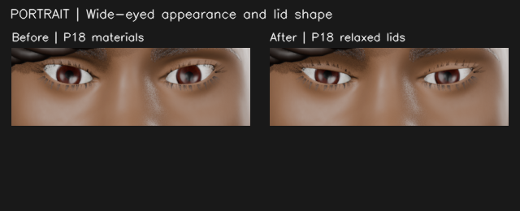
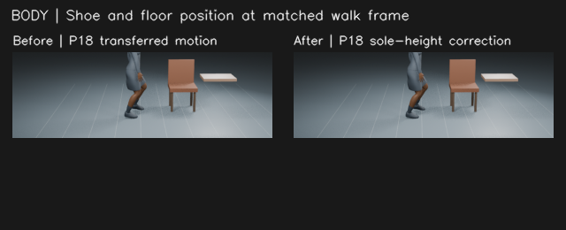
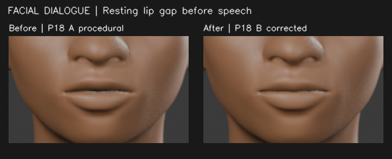

# Milestone report

## Report metadata

- Report date: 2026-11-23
- Milestone name: Phase 18 digital human reconstruction and performance correction
- Development status: PARTIAL
- Production status: NO-GO
- Private source branch: validation/phase18
- Source commit SHA: d7a302801a87ce5d24ebb333154490931b00eb75
- Private draft pull request: #4
- Reporting commit SHA: available in published history after approval.

## Executive summary

The intended digital actor now has an editable experimental revision with separate body and facial actions. Matched local tests compared the existing foundation, a repaired revision and a replacement candidate. Eye appearance and resting closure changed in the intended directions. Likeness, groom, shoe sliding and chair contact remain inadequate for production. No full scene or episode was rendered.

## Implemented features

| Component | Change | Status | Verification |
|---|---|---|---|
| Character Factory | Compared two foundations and assembled an editable experimental actor | Tested locally | Matched portraits and reopened actor |
| Digital Humans | Evaluated portrait shading and lid correction | Partial visual improvement | Private matched views |
| Body performance | Rendered eight test clips directly on the intended rig | Technical blockers remain | Floor, shoe and chair proxies |
| Facial dialogue | Rendered procedural, corrected procedural and retained sandbox variants | Technical blockers remain | Identical audio, camera and render settings |
| Owner review | Reused three independent evidence ledgers | Pending | Candidate records retained; no approvals entered |

## Testing and verification

156 backend tests, 24 frontend tests and the frontend production build passed. Real local Blender portrait, body and facial results were produced. The editable actor reopened with both animation actions and encoded videos decoded. Human visual approval and complete contact and facial anatomy validation were not obtained.

### Visual evidence

Each pair uses the same camera, lighting and render settings. Body and dialogue pairs show the same source frame in both panels.

The relaxed-lid trial reduced the wide-eyed look. Eyelid and lash fit, groom and overall likeness remain below acceptance.

Sole-height correction removed sampled floor penetration. The walking shoe-slide proxy worsened and the sitting overlap flag remains. This still cannot demonstrate natural gait.

The corrected procedural candidate reduced the resting lip gap. This frame was captured before speech and cannot establish lip synchronization. Oral collision and phoneme-level timing remain unverified. Synchronized comparison videos are retained privately for human review.

## Performance

On an RTX 4070 Ti SUPER, 900 × 900 portrait batches took about 6 to 9 seconds. The corrected 640 × 360 body batch took 61.99 seconds. The 512 × 512 dialogue renders ran at 24 fps. Peak whole-device sampling across the experiments reached 2,305 MiB. These are workstation measurements and exclude packaged installation testing.

## Known problems

| Severity | Problem | Impact | Planned Correction |
|---|---|---|---|
| Release blocker | Likeness and groom remain below target | Portrait gate blocked | Resolve eye, hair and wardrobe anatomy with matched human review |
| Release blocker | Sole penetration improved but sliding increased and seat overlap remained flagged | Body gate blocked | Validate calibrated retargeting and planted contacts |
| Release blocker | Resting lip gap reduced but synchronization improvement unverified | Facial gate blocked | Check oral collision and independently compare phone timing |
| Release blocker | Owner visual decisions pending | No gate can PASS | Collect approvals separately after technical closure |

## Experimental integrations

Retained Audio2Face sandbox outputs were compared. No new inference, dependencies or production integration were introduced. Existing video, audio and publishing workflows were preserved.

## Security and privacy

SANITIZATION PASS for the proposed documentation after local validation. Only summaries and aggregate figures are included. Visual assets, source, raw logs and measurements remain private. Publication requires explicit owner approval.

## Production readiness

NO-GO. All three actor quality gates remain technically blocked and owner review is pending. Historical workstation and release validation blockers remain open.

## Next priorities

1. Correct eye, hair and garment defects and verify clearance and likeness under matched conditions.
2. Compare a calibrated body retarget with measured shoe and chair contact and no sliding regression.
3. Validate oral geometry and independent phoneme-to-shape timing on the selected rig.

## Questions for ChatGPT

1. What screening criteria best identify a professional editable foundation with the required rights and rig controls?
2. What contact metrics best separate shoe sliding, rolling and transition between stance and swing?
3. How should oral collision and phoneme-timing defects be scored independently?

## Developer declaration

I have separated verified results from assumptions, disclosed known failures, and excluded private source code and sensitive information.
