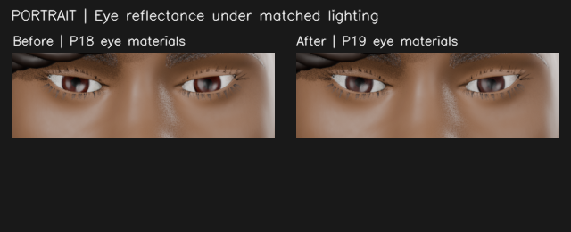
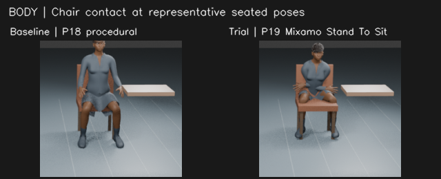
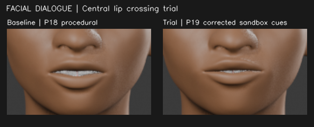

# Milestone report

## Report metadata

Phase 19 captured-motion and actor evaluation, 2026-11-23. PARTIAL. Private source commit 9deadff235d05bffd081622fd5563ca9cbe553d3, draft PR #5.

## Executive summary

Local matched portrait and facial tests, and genuine motion capture rendered on the actual actor. No foundation or actor qualified for production.

## Implemented features

| Area | Result |
|---|---|
| Portrait | Matched shading studies and a local replacement comparison |
| Body | Captured walk, turn, chair entry and rise retargeted to the actual actor |
| Facial | Matched procedural and retained sandbox comparisons |
| Review | Independent owner decisions still pending |

## Testing and verification

163 backend tests and 24 frontend tests passed. Frontend production build passed. Real GPU footage and editable action reopening verified.

### Visual evidence

These cropped images use matched cameras, lighting and render settings. The seated comparison shows representative poses from different actions.

Shading changed modestly. Likeness, groom and garment fit remain open.

Captured motion reached a seated pose. The chair overlap proxy regressed versus the previous procedural take.

A narrow closure proxy improved in the sandbox. Oral anatomy and independent timing remain incomplete.

## Performance

Blender ran on the RTX 4070 Ti SUPER. Matched portraits were 900 × 900 and comparison videos delivered at 24 fps. Walking and sitting correction trials took about 15 and 23 seconds.

## Known problems

Professional foundation and likeness are unqualified. Standing contacts lack coverage in key shots. Chair overlap persists. Independent facial timing and owner acceptance remain open.

## Experimental integrations

Mixamo was used only in the local deterministic Blender sandbox. Retained Audio2Face curves were evaluated separately. No production integration.

## Security and privacy

SANITIZATION PASS for the proposed snapshot. Only permitted preview crops and report summaries are staged. Publication requires explicit owner approval.

## Production readiness

NO-GO. All three character gates remain BLOCKED. Reduced floor penetration did not establish better sliding, and walking root movement regressed in the correction trial.

## Next priorities

1. Qualify an editable professional foundation and exact license.
2. Validate planted contact and chair blocking on the intended rig.
3. Validate independent speech timing and oral anatomy.

## Questions for ChatGPT

1. Which anatomy criteria should gate a professional base?
2. Which contacts separate stance and toe roll most reliably?
3. How should seating clearance be measured across a transition?

## Developer declaration

I have separated verified results from assumptions, disclosed known failures, and excluded private source code and sensitive information.
