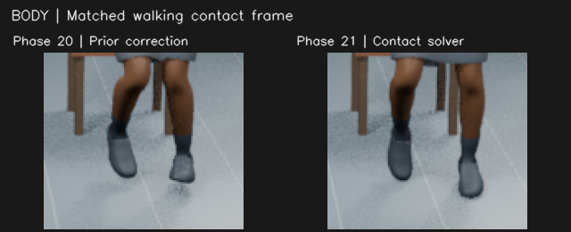

# Milestone report

## Report metadata

Phase 21 contact-aware motion, 2026-11-24. PARTIAL. Private source commit 66e1b7917e4a09f38d569b8e903690d6666b09b9.

## Executive summary

A controlled experiment improved walking contact estimates and preserved root travel. The actor still intersects the chair. The candidate remains unsuitable for production.

## Implemented features

| Area | Result |
|---|---|
| Body | Independent foot contact and bounded pelvis trials on the intended actor |
| Retarget | Isolated arm alignment proof and editable animation |
| Portrait and facial dialogue | Outside this body-only milestone |

## Testing and verification

176 backend tests and 24 frontend tests passed. Frontend production build passed. Real GPU renders and reopening of six actor assets passed. Human approval is pending.

### Visual evidence

The proposed frame is matched for camera, lighting and motion time. Walking contact displacement improved over the same inferred intervals. The crop does not establish accurate phase labels or a visual approval.

## Performance

RTX 4070 Ti SUPER. Four calibrated render trials used 640 × 360 at 30 fps. Each took about 18–84 seconds, with a peak sampled GPU-wide usage of 2,123 MiB.

## Known problems

Inferred peak walking stance displacement declined from 3.65 to 1.57 cm versus the prior correction on the same labels. Raw was 2.04 cm. Sitting still reached 3.60 cm measured chair penetration. Turn pivot accuracy, seated support and contact-safe transitions remain unresolved.

## Experimental integrations

Offline deterministic motion retargeting and collision checks. No production integration.

## Security and privacy

SANITIZATION PASS for the proposed snapshot. The low-resolution crop and report await approval. Original files and footage remain private.

## Production readiness

NO-GO. Walking measurements improved. The body candidate failed chair and transition validation. Human acceptance is pending.

## Next priorities

1. Independently annotate stance and roll from a foot-visible reference.
2. Test a controllable pelvis and toe rig with coupled foot and chair constraints.
3. Require collision-free seated support and natural transitions before requesting approval.

## Questions for ChatGPT

1. Which reference captures will let reviewers label stable pivots reliably?
2. How can the stance solver maintain support when the pelvis also has a seat constraint?
3. Which seam metrics best reject abrupt transitions without penalizing intentional pivots?

## Developer declaration

I have separated verified results from assumptions, disclosed known failures, and excluded private source code and sensitive information.
