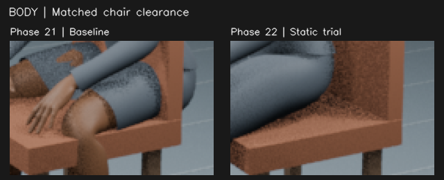

# Milestone report

## Report metadata

Phase 22 chair contact session, 2026-11-25. PARTIAL. Source revision e7b2fbd90d7ed1aaa7b377b109189231d733b955.

## Executive summary

The static seat test failed. The actor maintained floor clearance and cleared the backrest in the selected pose. Body and clothing still intersected the seat.

## Implemented features

| Area | Result |
|---|---|
| Body | Independent foot targets and static seat validation |
| Animation | Sit and rise were deferred after the static gate failed |

## Testing and verification

Nine focused solver tests passed. The Blender candidate reopened and matched side-view stills rendered. Historical input checksums matched. Owner visual review is pending.

### Visual evidence

The cropped comparison shows the seated baseline and selected static trial under the same camera. Backrest clearance improved. Seat intersection remains.

## Performance

Static stills only. No new performance benchmark was recorded.

## Known problems

Measured penetration reached 1.35 cm for the body and 3.31 cm for the suit. The sampled alternative without detected contact penetration hovered 6.34 cm above the seat.

## Experimental integrations

Offline rigging experiment. No production integration.

## Security and privacy

SANITIZATION PASS for the public summary and cropped preview. Editable assets and full renders remain private.

## Production readiness

NO-GO. The static chair gate failed. Human approval is pending.

## Next priorities

1. Calibrate independent pelvis rotation.
2. Test seated thigh and garment deformation.
3. Require stable seat support before testing continuous motion.

## Questions for ChatGPT

1. Which seated pose measurements best distinguish support from hovering?
2. How should clothing deformation be assessed independently of the body?
3. Which static checks should gate transition tests?

## Developer declaration

I have separated verified results from assumptions, disclosed known failures, and excluded private source code and sensitive information.
