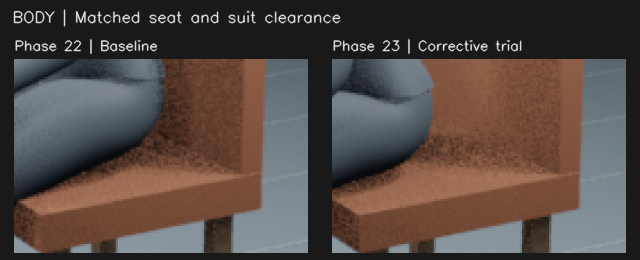

# Milestone report

## Report metadata

Phase 23 seated pelvis and suit trials, 2026-11-25. PARTIAL. Source revision f895e557f4e51a541af1dbed764c3fc0d91ab54a.

## Executive summary

Pelvis calibration cleared sampled body-to-seat penetration while maintaining both shoe targets. The suit correction traded seat collision for a suit-to-body intersection. Static acceptance failed.

## Implemented features

| Area | Result |
|---|---|
| Body | Pelvis rotation calibrated against chair surface |
| Clothing | Two editable seated corrective passes |

## Testing and verification

Nine focused solver tests passed. Blender rendered and reopened the private candidate. Owner visual review is pending.

### Visual evidence

The matched crop shows the static pose and suit changes. The numerical checks identified an internal clothing intersection.

## Performance

Static renders only. No new motion benchmark.

## Known problems

Body seat penetration fell from 1.35 cm to zero in the sampled vertices. The closest posterior body point was 0.75 cm above the seat, with five support-zone vertices compared with the required eight. The first clothing pass left 1.49 cm of seat penetration. The second cleared sampled seat penetration but introduced a 6.78 cm moved-patch body-intersection estimate.

## Experimental integrations

Offline Blender pose and garment trials. No production integration.

## Security and privacy

SANITIZATION PASS. Full evidence and editable assets remain private.

## Production readiness

NO-GO. The seated pose failed static support and clothing acceptance. No motion was baked.

## Next priorities

1. Qualify a seated garment with thickness and fit checks.
2. Verify broader seat support with a side review.
3. Bake motion only after static acceptance.

## Questions for ChatGPT

1. Which fit checks are best for seated garments?
2. How should seat support coverage be measured?
3. Which pose controls should remain user-editable?

## Developer declaration

I have separated verified results from assumptions, disclosed known failures, and excluded private source code and sensitive information.
