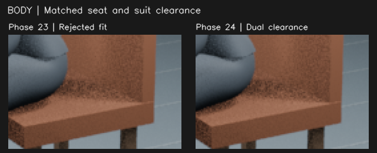

# Milestone report

## Report metadata

Phase 24 seated garment fit, 2026-11-26. PARTIAL. Source revision 1a3624d6a38e2261e981c3674beae1e92733daeb.

## Executive summary

The first dual-clearance trial reduced seat penetration while detecting no body penetration on the moved patch. Residual chair collision and garment distortion failed static acceptance.

## Implemented features

A bounded local garment fit checked each proposed displacement against the actor and chair.

## Testing and verification

Nine focused solver tests passed. Blender rendered and reopened the editable trial. Human approval is pending.

### Visual evidence

Matched seat crops show two experimental garment fits. Visual inspection is separate from measured collisions.

## Performance

Static stills only. No new motion benchmark.

## Known problems

Maximum sampled suit-to-chair depth fell from 3.47 cm to 2.95 cm. The most stretched measured edge in the adjusted region reached 1.95 times its original length. Seat support remains unqualified.

## Experimental integrations

Offline garment fitting trial. No production integration.

## Security and privacy

SANITIZATION PASS. Full evidence and editable assets remain private.

## Production readiness

NO-GO. The static garment trial failed. No motion was baked.

## Next priorities

1. Test a different seated garment on the same pose.
2. Verify seat support before baking motion.
3. Inspect a matched sit and rise only after static acceptance.

## Questions for ChatGPT

1. Which garment constraints best limit local stretch?
2. Which seat clearance measures should gate animation?
3. How should the seated garment fit transfer throughout the motion?

## Developer declaration

I have separated verified results from assumptions, disclosed known failures, and excluded private source code and sensitive information.
